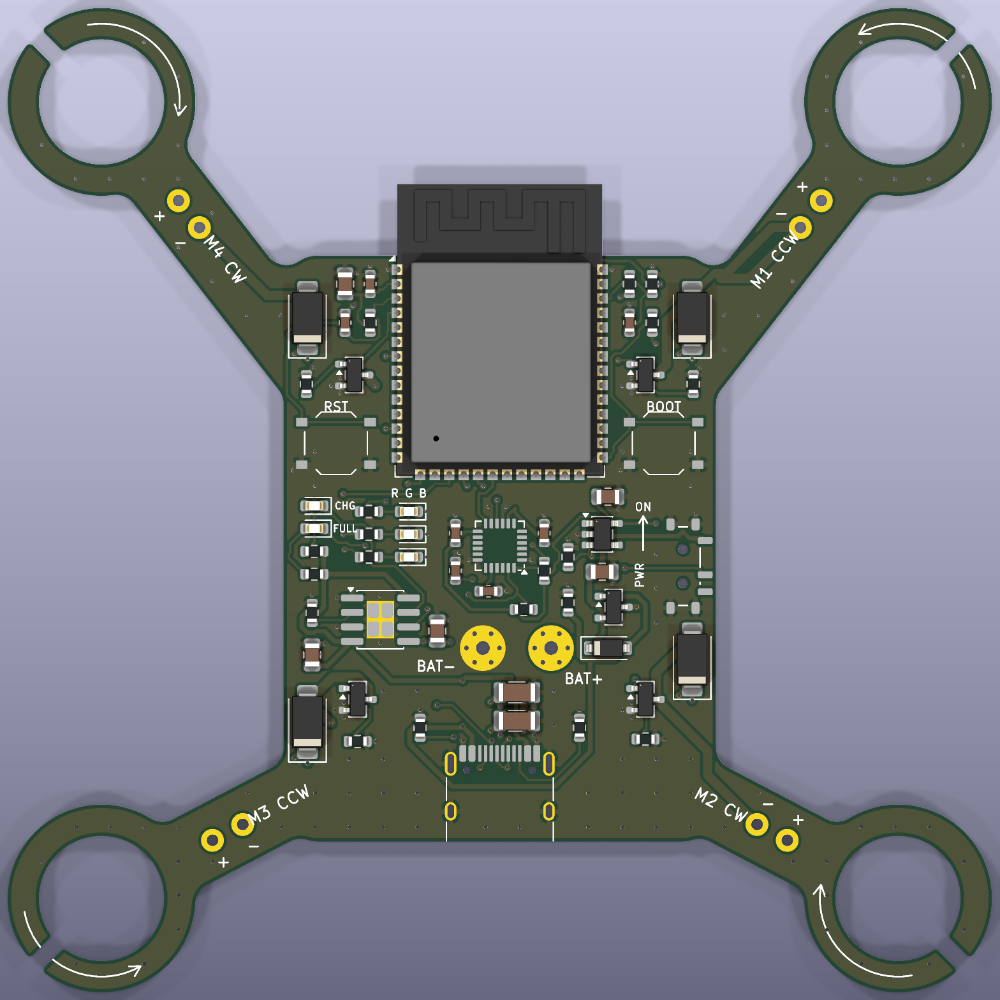

# ESP-Drone S3: PCB-frame micro quadcopter

A 4-layer, 86.5 × 86.5 mm flight controller that is also the drone frame. It uses
brushed 720 motors clamped in rubber motor rings, runs Espressif's open-source
[ESP-Drone](https://github.com/espressif/esp-drone) firmware unmodified, and is
flown from a phone over Wi-Fi.



## Folder contents

| Path | What it is |
| --- | --- |
| `production/esp_drone_s3_gerbers.zip` | Upload this to JLCPCB as the PCB |
| `production/esp_drone_s3_bom.csv` | Bill of materials with LCSC part numbers (JLCPCB format) |
| `production/esp_drone_s3_bom_lcsc_shopping.csv` | Same parts for buying loose from LCSC (three capacitors swapped for in-stock cut-tape equivalents) |
| `production/esp_drone_s3_assembly_guide.html` | Interactive placement guide for hand assembly |
| `production/esp_drone_s3_cpl.csv` | Pick-and-place file with JLCPCB rotation and centroid corrections applied |
| `production/esp_drone_s3_netlist.csv` | Every net and the pins it connects (the design has no schematic sheet) |
| `production/render_*.png` | 3D renders |
| `kicad/` | KiCad 10 project. Open `esp_drone_s3.kicad_pro` |
| `tools/` | Scripts that generate the whole board (`tools/pipeline.sh`, then `tools/fab.py`) |

## Hardware summary

- **MCU:** ESP32-S3-WROOM-1-N8. The antenna overhangs the front edge, as Espressif recommends.
- **IMU:** MPU-6050 at the centre of the frame, oriented to match ESP-Drone's axis remapping.
- **Power:** 1S LiPo on solder pads. A load-sharing power path feeds the AP2112K 3.3 V regulator from USB or the battery. A TP4056 charges the battery at 400 mA over USB-C. A slide switch turns the electronics on and off (charging works with the switch off).
- **Motor drivers:** four AO3400A low-side MOSFETs with SS34 flyback diodes and gate pull-downs, so the motors stay off during boot.
- **Board:** 4 layers, 1.6 mm. Inner layer 1 is a solid ground plane. Inner layer 2 is a solid battery (VBAT) plane that runs into every arm, so motor current never goes through thin traces.
- **Also on board:** battery voltage sense (1:2 divider on GPIO2), status LEDs, charge and full LEDs, BOOT and RESET buttons, and native USB for flashing.
- **Geometry:** motors are 70 mm apart (99 mm diagonal), which fits 55 mm props (65 mm maximum).

The pin map is identical to ESP-Drone's default for ESP32-S3 (`TARGET_ESP32_S2_DRONE_V1_2`):

| Function | GPIO | | Function | GPIO |
| --- | --- | --- | --- | --- |
| M1 front-right (CCW) | 5 | | MPU-6050 SDA / SCL | 11 / 10 |
| M2 rear-right (CW) | 6 | | MPU-6050 INT | 12 |
| M3 rear-left (CCW) | 3 | | Battery ADC | 2 |
| M4 front-left (CW) | 4 | | LED red / green / blue | 8 / 9 / 7 |
| USB D- / D+ | 19 / 20 | | BOOT | 0 |

## Ordering at JLCPCB

1. Go to jlcpcb.com and upload `production/esp_drone_s3_gerbers.zip`.
   - Layers: **4** (detected automatically). Thickness **1.6 mm**. Everything else can stay at the defaults.
   - Surface finish: ENIG is recommended for the QFN IMU; lead-free HASL also works.
   - Remove order number: choose **Specify a location**. A `JLCJLCJLCJLC` marker is already on the bottom silkscreen.
2. Turn on **PCB Assembly**: top side, any quantity (2 is the minimum).
   - If JLCPCB asks about edge rails for the irregular outline, pick **Added by JLCPCB** on the **left and right** sides. The module overhangs the front edge, so the front has to stay free.
3. Upload `esp_drone_s3_bom.csv` and `esp_drone_s3_cpl.csv`.
4. On the placement preview page, check the parts against the render above. The rotations are already corrected, but this preview is your last free check.
   - The ESP32 antenna points to the front, past the board edge.
   - The USB-C opening faces outward at the rear.
   - The MPU-6050 pin-1 dot is at the lower right of the chip.
5. Expect about 8 "extended part" setup fees (ESP32-S3 module, MPU-6050, TP4056, AP2112K, USB-C, green LED, blue LED, slide switch). Everything else is a basic part.

Stock was checked on 2026-11-04. The tightest parts were ESP32-S3-WROOM-1-N8 (C2913198, about 4,600 in stock) and MPU-6050 (C24112, about 6,600). If either sells out, the BOM page will flag it before you pay.

## Parts to buy separately

- 4 × 720 brushed coreless motors (7 × 20 mm), 2 CW and 2 CCW
- 4 × rubber motor rings for 7 mm motors (11 mm outer diameter, sold as "716/720 motor rubber ring")
- 55 mm propellers: 2 × A (CW) and 2 × B (CCW), matched to the motor shaft size
- 1S LiPo, 300 to 500 mAh, 20C or higher

## Assembly

1. **Motors:** push each motor, inside its rubber ring, into the clamp ring. The silkscreen shows the layout and spin direction: M1 front-right CCW, M2 rear-right CW, M3 rear-left CCW, M4 front-left CW.
2. **Motor wires:** solder each motor's positive lead to the `+` pad on its arm and the negative lead to `-`. Usually red/blue wires are CW motors and white/black are CCW. Before fitting props, confirm each motor spins in the direction of the arrow on its ring.
3. **Battery:** solder the leads to **BAT+ / BAT-** (also labelled on the bottom), or solder on a pigtail with your battery's connector. **There is no reverse-polarity protection.** Connecting the battery backwards will destroy the charger and regulator. Stick the battery to the centre of the bottom side with foam tape.
4. **Props:** fit the A props on M2 and M4, and the B props on M1 and M3.

## Firmware (no configuration changes needed)

```sh
# ESP-IDF release/v5.5 environment
git clone https://github.com/espressif/esp-drone.git && cd esp-drone
idf.py set-target esp32s3
idf.py build
# slide the power switch to ON, plug in USB-C
idf.py -p /dev/cu.usbmodem* flash monitor
```

The ESP32 is only powered when the slide switch is **ON**, including when it's on USB. If the port doesn't appear, hold **BOOT**, tap **RST**, then release **BOOT**.

To fly, install the ESP-Drone app (Android or iOS) and join the Wi-Fi network `ESP-DRONE_<mac>` with password `12345678`.

## First power-up (props off)

1. **USB only:** plug in USB-C with the switch ON. The ESP-Drone LED sequence should start, and the 3V3 rail should read 3.3 V.
2. **Charging:** with the battery connected and USB in, the CHG LED is lit while charging and the FULL LED lights when charging finishes.
3. **Motors:** run a motor test from the app with the props still off.

## Verification status

What has been checked:

- **KiCad design-rule check:** 0 errors, 0 unconnected items. This covers clearances, hole spacing, courtyard overlaps, and plane connectivity, and uses JLCPCB-standard rules (0.15 mm minimum track and space, 0.3 mm drills, no extra-cost options).
- **Firmware match:** every GPIO, the IMU address (0x68), the IMU axis orientation, LED polarity, the battery divider ratio, and the motor numbering and spin directions were checked against the esp-drone source code.
- **Datasheets:** the MPU-6050 pin handling follows the datasheet in the esp-drone repo. The TP4056, AP2112K, and USB-C CC resistors follow their standard reference circuits.
- **Placement file:** rotation and centroid for every part were computed by matching KiCad pads against JLCPCB's own footprint for that LCSC number (`production/jlc_corrections.txt`).

What hasn't been checked:

- The board has not been physically built or flown.
- JLCPCB's human DFM review still runs after you upload.
- There is no schematic sheet. The circuit is defined in `tools/design.py` and exported as `production/esp_drone_s3_netlist.csv`.

## Regenerating

Requires KiCad 10, Java 21+ (Homebrew `openjdk@25` path is set in `tools/route.py`), and shapely in KiCad's Python:

```sh
<KiCad python> -m pip install --target tools/pylib "shapely<2.1"
tools/pipeline.sh                                    # place, autoroute (Freerouting 2.5, auto-downloaded), finish, DRC
PYTHONPATH=tools/pylib <KiCad python> tools/fab.py  # BOM, CPL, Gerbers, renders
```

Edit `tools/design.py` to change parts, nets, or placement.
